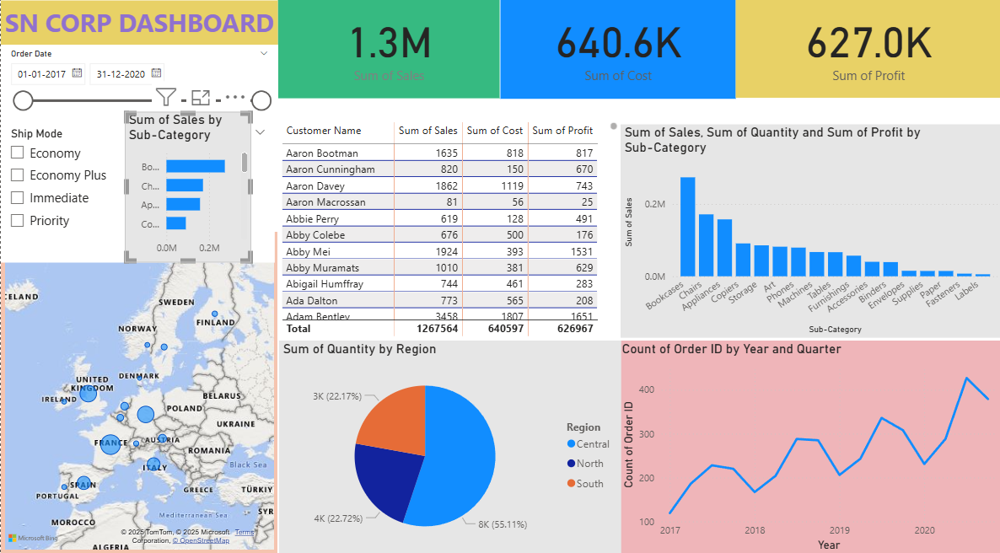

# SN Corp Sales Dashboard (Power BI)

Interactive Power BI dashboard analyzing sales, cost, and profit across 4,115 orders, 15 countries, and 17 product sub-categories (2017–2020).

## Dataset
Sample sales dataset used in the SkillNation Power BI training.

## Tools
Power BI, Excel

## Key Findings
- Total sales of about 1.3M, cost of 640.6K, and profit of 627.0K
- Bookcases are the top sub-category by sales (about 274K), followed by Chairs and Appliances
- Central region accounts for 55% of quantity sold
- Quarterly orders grew from 119 (Q1 2017) to 427 (Q3 2020)

## Dashboard

